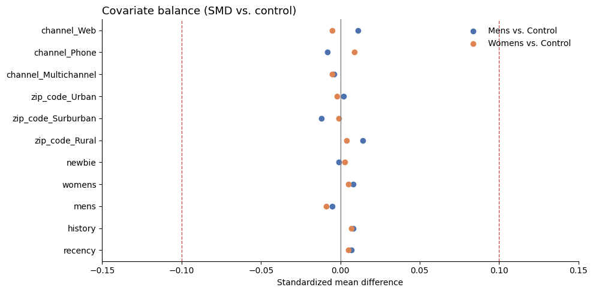
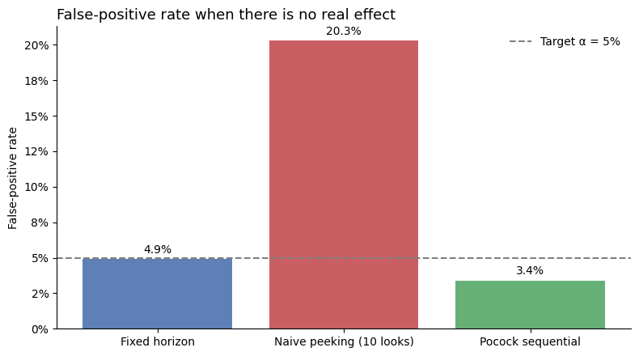
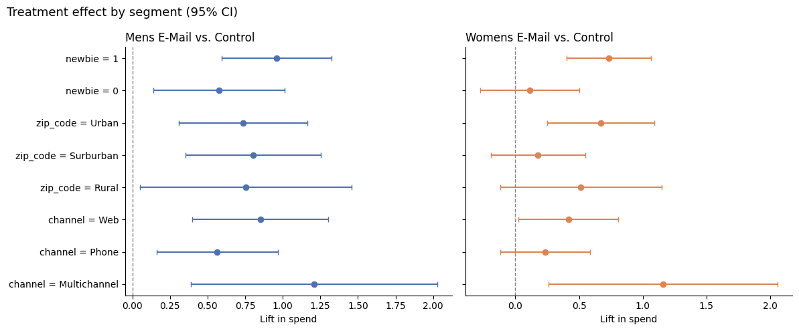

# Re-Engagement Email Experiment: Should We Ship, and Which Version?

End-to-end analysis of a 64,000-customer, three-arm randomized email experiment, from randomization checks to a ship / don't-ship decision.

**Stack:** Databricks · PySpark · Python (pandas, scipy, statsmodels, matplotlib)

---

## Recommendation: Ship the Men's email

Both emails significantly increased visits, conversions, and spend vs. no email. Head-to-head, the Men's email drove **significantly more visits and conversions** than the Women's email and **directionally higher spend** (not statistically conclusive). It was also the only version that lifted spend in every customer segment.

| Metric (vs. no email) | Control | Men's email | Women's email |
|---|---|---|---|
| Spend per customer | $0.65 | **+$0.77 (+118%)**, 97.5% CI [$0.44, $1.10] | **+$0.42 (+65%)**, 97.5% CI [$0.13, $0.72] |
| Visit rate | 10.6% | **+7.7 pp (+72%)** | **+4.5 pp (+43%)** |
| Conversion rate | 0.57% | **+0.68 pp (+119%)** | **+0.31 pp (+54%)** |

All lifts significant at the Bonferroni-adjusted α = 0.025.

**Men's vs. Women's head-to-head:** spend +$0.35 (p = 0.031, not significant at α = 0.025); visits +3.14 pp (p < 0.001); conversions +0.37 pp (p < 0.001).

**Business impact:** every 10,000 customers emailed generates roughly **$7,700** in additional two-week revenue with the Men's email vs. ~$4,200 with the Women's email. The gap between the two is a point estimate, not statistically confirmed.

---

## Why the results can be trusted

| Check | Method | Result |
|---|---|---|
| Sample ratio mismatch | Chi-square goodness-of-fit vs. planned 1/3 split | χ² = 0.20, p = 0.90, no SRM |
| Covariate balance | Standardized mean difference on pre-period covariates | max \|SMD\| = 0.014 (threshold 0.1) |
| Test calibration | 1,000 A/A splits of the control arm | 4.9% false-positive rate at α = 0.05 |
| Robustness to skew | Bootstrap CIs (5,000 resamples) vs. Welch's t-test | Intervals match almost exactly |
| Power | MDE at 80% power, α = 0.025 | Spend MDE = $0.35; both observed lifts exceed it |



---

## Analysis

1. **Data validation & EDA:** 99.1% of customers spent $0, so spend is zero-inflated and heavily skewed. 6,562 exact duplicate rows were retained: the data has no customer ID, so identical-looking rows are distinct customers.
2. **Randomization checks:** SRM test and covariate balance.
3. **Power analysis:** MDE per metric. Spend needs a 53% relative lift to be reliably detected; visit rate only 8.7%.
4. **A/A simulation:** confirms Welch's t-test is well-calibrated on spend despite the skew.
5. **Treatment effects:** Welch's t-test + bootstrap CIs on spend; two-proportion z-tests on visit and conversion.
6. **CUPED variance reduction:** tested with past-year spend as the covariate.
7. **Peeking vs. sequential testing:** simulation of the cost of checking results early.
8. **Segment analysis:** heterogeneous effects with Benjamini-Hochberg correction, plus a head-to-head test between the two emails.
9. **Decision memo:** recommendation, risks, and next steps.

### Peeking inflates false positives 4×

Checking an A/A test at 10 interim looks and stopping at the first p < 0.05 raised the false-positive rate from **4.9% to 20.3%**. A Pocock sequential boundary brought it back to **3.4%**.



### Segment effects

The Men's email lifted spend significantly in all 8 segments after Benjamini-Hochberg correction (12 of 16 comparisons significant overall). The Women's email had no detectable effect for Phone, Rural, Suburban, or existing customers.



### CUPED: tested, not applicable

The correlation between past-year spend and two-week spend was only 0.02, so CUPED produced no meaningful variance reduction. Past spend barely predicts a purchase within a specific two-week window when 99% of customers buy nothing. CUPED's benefit equals ρ², so it pays off on metrics with stronger pre-period correlation, such as weekly engagement.

---

## Risks and limitations
- **No guardrail metric:** unsubscribe and complaint rates weren't recorded.
- **Revenue, not profit:** spend excludes margin, email costs, and returns.
- **Short window:** two weeks of outcomes; long-term retention and pull-forward of purchases are unmeasured.
- **Segment results are exploratory:** hypotheses for targeting, not ship decisions.

## Next steps
1. Roll out the Men's email with a small holdout to track unsubscribes and longer-term revenue.
2. Test whether the Women's email outperforms for customers who previously bought women's merchandise.
3. Extend the outcome window to 30–60 days.

---

## Data

Kevin Hillstrom, *MineThatData E-Mail Analytics and Data Mining Challenge* (2008). The dataset isn't included in this repo. Download the CSV from the [MineThatData blog](https://blog.minethatdata.com/2008/03/minethatdata-e-mail-analytics-and-data.html) and place it in `data/`. It's also available in Python via `sklift.datasets.fetch_hillstrom()`.

| Column | Description |
|---|---|
| `recency` | Months since last purchase |
| `history` | Dollars spent in the past year |
| `mens` / `womens` | Purchased men's / women's merchandise in the past year |
| `zip_code` | Urban / Suburban / Rural |
| `newbie` | New customer in the past 12 months |
| `channel` | Purchase channel (Phone / Web / Multichannel) |
| `segment` | Experiment arm: Mens E-Mail, Womens E-Mail, No E-Mail |
| `visit` / `conversion` / `spend` | Outcomes in the two weeks after the email |

## Repository

```
├── AB_testing.ipynb   # full analysis with outputs
├── images/            # charts used in this README
└── data/              # place the Hillstrom CSV here (not tracked)
```
